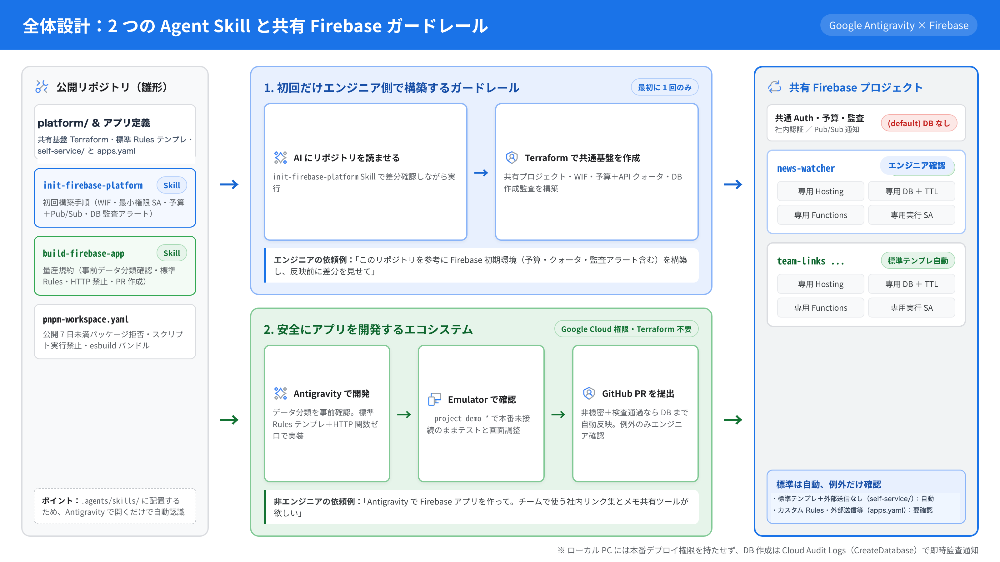
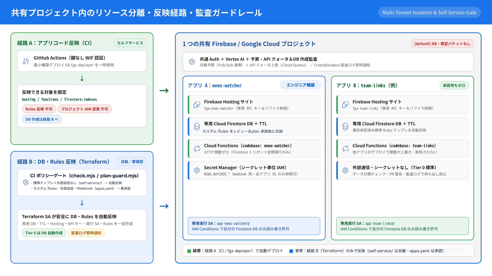
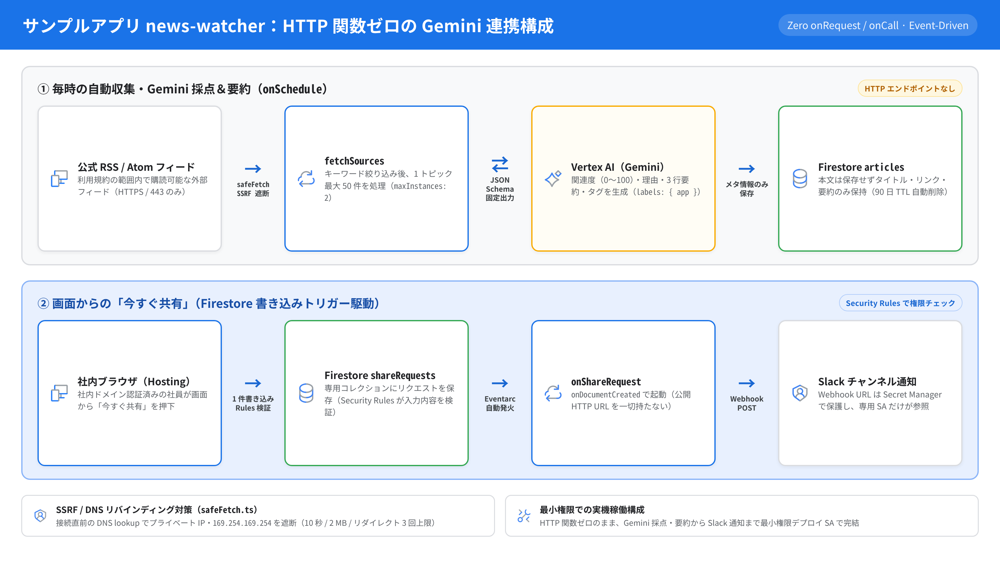

この記事は「2026 Google Cloud Japan Advent Calendar」2日目の記事です。
Google Cloud Japan でカスタマーエンジニアをしている 海沼玲史(@reizist) です。

本記事は、Antigravity を使ってガバナンスを効かせたアプリ量産体制を構築する方法を具体例と共にまとめたものです。主目的としては人間の手で人間に向けて書いているものなので読んでいただけると嬉しいですが、生成 AI に読ませればそのまま環境構築できる仕立てになっていますので、必要に応じて記事リンクを AI に共有して進めてみてください。


:::message
**この記事の想定読者と読み方**
Google Cloud やインフラの経験にかかわらず、生成 AI やエージェント開発ツールに関心がある方を対象にしていますが、Google Cloudを全面的に採用した構成になっています。
前半で概要/背景に触れ、後半では 2つのフェーズ - 1.エンジニアが最初に用意するガードレール構成 / 2. 非エンジニア向けの開発フロー、サンプルアプリの実例 を交えつつ詳細を書いています。
クラウド用語に馴染みがない方は、下のミニ解説をざっと見てから読み進めてください。
:::

## TL;DR

- 社内アプリを安全に量産する環境を [Google Antigravity](https://antigravity.google) と Firebase を使い構築します。共有プロジェクトに複数アプリを分離して同居させる仕組みを検証しました。
- 長い規約書を配る代わりに、初期構築とアプリ量産のルールを [Agent Skills](https://antigravity.google/docs/skills)（`.agents/skills/`）にまとめ、**リポジトリを AI に読ませるだけで使い始められる**形にしています。
- DB 作成のたびに承認待ちが発生するのを避けるため、**標準 Rules テンプレートを使い外部送信・シークレットを持たない** Tier 0 アプリは `self-service/` への定義追加だけで承認待ちなしで DB 払い出しまで自動化しつつ、**予算アラート（Pub/Sub 連携）＋DB 作成監査ログ＋事前データ分類確認**でコスト暴走と社内データの持ち出しを押さえています。
- サンプルの Gemini 連携アプリ `news-watcher` をこの上で動かし、最小権限の `firebase deploy` で実際に踏んだ 6 つの罠への対処まで Terraform とデプロイスクリプトに組み込みました。

**端的にはこれを実行すれば始められます**（公開リポジトリ: https://github.com/reizist/antigravity-firebase-guardrail を複製して Antigravity で開くだけ）:

- **エンジニア（初回 1 回のみ）**:
  > 「`/init-firebase-platform` を使って Firebase 共有基盤を初期構築して。クラウドへ反映する前に必ず `plan` を見せて。」
- **アプリ作成者（非エンジニア含む・2 回目以降）**:
  > 「`/build-firebase-app` を使って、チームで使う社内リンク集とメモ共有ツールを作って。」

:::details クラウド／AI 用語ミニ解説（Google Cloud に初めて触れる方向け）
- **Google Antigravity**: Google が提供するエージェントファーストの開発環境。エディタ・ターミナル・ブラウザ確認を AI エージェントと協調して進められます。
- **Agent Skill**（`SKILL.md`）: AI エージェントに特定の手順や運用制約を伝えるための標準的なフォルダ形式。Antigravity ではリポジトリ内の `.agents/skills/<スキル名>/SKILL.md` に置くと自動で認識され、自然言語の依頼や `/<スキル名>` で呼び出せます。
- **Firebase Hosting / Cloud Firestore / Cloud Functions**: それぞれ Web 画面の配信、NoSQL データベース、サーバーレス関数実行を担う Firebase（Google Cloud 上）のマネージドサービスです。
- **Security Rules**（Firestore Security Rules）: データベースに対して「誰がどのデータを読み書きできるか」を制御するアクセスルールです。
- **サービスアカウント**（SA）: 人間ではなく、アプリや CI がクラウドを操作するために使う専用アカウントです。
- **Terraform**: クラウド上のリソース構成をコードで宣言し、再現性高く構築・更新するための IaC ツールです。
- **IAM / Workload Identity Federation**（WIF）: 誰がどのリソースを操作できるかを制御する仕組み（IAM）と、秘密鍵ファイルを発行せずに GitHub Actions などから一時認証でクラウドを操作する仕組みです。
:::

## はじめに: 「非エンジニアだけで簡易アプリを量産したい」の壁
最近の生成AIの進化は目覚ましく、非エンジニアの方々がそれなりの規模感のアプリケーションを開発したポストや実例を多く見かけるようになりました。
書類申請・経費精算の仕組みだったり、営業資料作成の効率化を行ってみたりと、今では仕組みの開発はソフトウェアエンジニアだけの仕事ではなくなりつつあります。

会社全体として見ると生産性を上げる良い動きである一方、実際のところ 2026/11 現在、明確に問題点は残ります。**それはガバナンスです**。

個人開発としてならまだしも、会社内でシステムを量産された場合にプライバシーポリシーやセキュリティの観点が考慮されているか、または運用可能な状態かの担保は必須です。
現状はソフトウェアエンジニアの関与（レビュー等）は不可欠であり、非エンジニアは不便を感じ、エンジニアは五月雨・非同期のレビューに追われる、というような事象が起こっているのではないでしょうか。

そこでここではFirebaseに焦点を当て、 **非エンジニアでもアプリを量産させられるガードレール** について書きました。

## なぜFirebaseか

社内の非エンジニアに「Google Cloud(または任意のクラウド)を自由に使ってよい」と開放すると、今度は自由度の高さ自体がガバナンスの壁になります。
Compute Engine・GKE・Cloud SQL・VPC・ロードバランサなど数百の選択肢があると、作る人や AI エージェントごとに構成がバラバラになりやすく、ネットワーク設定ミスや常時稼働リソースの放置課金が起きがちです。
結果として、統制する側もプロジェクト払い出し・VPC 設計・組織ポリシー・個別レビューと大掛かりな仕組みを用意しなければなりません。

その点、Firebase にはアプリ開発に必要な要素（画面配信・認証・DB・イベント駆動の関数）が最初から 1 セットに絞られており、**ほどよい制約** があります。

| 観点 | Google Cloud をそのまま開放 | Firebase ガードレールで渡す |
| :--- | :--- | :--- |
| 構成の自由度 | VM・コンテナ・RDB・VPC まで何でも選べるため、レビュー観点が毎回変わる | Hosting・Auth・Firestore・Functions の定番構成に揃い、AI の生成結果も安定しやすい |
| インフラ・固定費 | ネットワーク構築や常時稼働リソースの停止漏れ対策が必須 | サーバーレス中心で VPC 設計が不要。使われないアプリの固定費が膨らみにくい |
| アクセス制御 | 個別の API 実装ごとに認証・認可ロジックを精査する必要がある | Firestore Security Rules に集約でき、標準テンプレート化や静的検査がしやすい |
| ローカル検証 | 開発用のクラウド環境や接続権限を個人へ渡しがち | Local Emulator Suite で本番未接続（`--project demo-*`）のまま手元完結できる |

さらに重要なのは、Firebase の裏側が Google Cloud そのものである点です。
アプリ作成者には Firebase のシンプルな枠だけを見せつつ、プラットフォーム側は IAM Conditions・Workload Identity Federation・Secret Manager・Cloud Audit Logs・予算アラート・Vertex AI（Gemini）といった Google Cloud の統制機能や AI 機能をそのまま組み込めます。

### Vercel や Cloudflare ではなく Google Cloud（Firebase）を選ぶ理由

近年は Vercel や Cloudflare（Pages / Workers 等）も、非エンジニアや AI エージェントが素早くアプリを公開できる環境として広く使われています。単発のプロトタイプや公開 Web サイトの立ち上げでは、これらの環境も優れた選択肢です。

一方で、「**企業の中で社内向け業務アプリを継続的に量産・統制する**」前提に立つと、Firebase / Google Cloud には次の強みがあります。

- 契約・認証・統制の窓口を増やさない: すでに Google Workspace や Google Cloud を利用している組織であれば、新規の外部クラウド契約や個別のアカウント棚卸しを増やさず、既存の社内ドメイン認証・課金アカウント・組織ポリシー（リージョン制限や社外共有禁止など）の傘下で一括管理できます。
- 社内データと生成 AI を同じクラウド境界内で扱える: アプリごとに外部 LLM の API キーを発行・配布する代わりに、アプリ専用 SA の IAM 権限で東京リージョンの Vertex AI（Gemini）を直接呼び出せます。`labels: { app }` によるアプリ別の費用集計や、将来的な BigQuery 等の社内データ基盤との連携も同じ IAM 基盤の上で進められます。
- 権限分離と監査を Google Cloud 標準機能で統一できる: IAM Conditions による DB 単位のアクセス制限、Secret Manager のシークレット単位 IAM、Cloud Audit Logs による DB 作成の即時検知、Artifact Registry による npm パッケージ取得元の一本化まで、すべて Terraform で一元管理できます。
- アプリが育ったときの移行先が同じクラウド上にある: 簡易ツールが本格的な業務システムへ成長しても、別プラットフォームへ載せ替える必要はありません。同じ Google Cloud 上の専用プロジェクト、Cloud Run と社内認証プロキシ（IAP）、Cloud SQL、VPC 経由の通信制御へ段階的に引き上げられます。

## なぜAntigravityか

本構成はオープンな形式の Agent Skills（`SKILL.md`）と Terraform・CI をベースにしているため、Claude Code や Codex、Cursor など他の AI 開発ツールからでも同じ仕組みを利用できます。

そのうえで、Google Cloud / Firebase で社内アプリを量産する環境として Google Antigravity をおすすめする理由は次の 3 点です。

- 複数モデルを 1 つの環境で使い分けられる: [モデル選択機能](https://antigravity.google/docs/models)により、Gemini だけでなく Claude や GPT-OSS などの外部モデルも同じツール内で切り替えられます。
  - タスクに応じて推論の深さを変えたり、設計と実装でモデルを組み合わせたり（Orchestrator）できるため、特定のモデルに縛られず運用できます。
- Firebase 公式 Skill を含むセットアップが Google シナジーで速い: [Firebase 公式の Agent Skills](https://firebase.google.com/docs/ai-assistance/agent-skills) が [Antigravity Marketplace](https://antigravity.google/docs/marketplace) の Firebase プラグインとして用意されており、オンボーディング時のチェックやワンクリックで導入できます。手動の CLI 設定を最小限に抑えつつ、Firebase・Google Cloud の最新パターンに沿った環境をすぐ立ち上げられます。
- 非エンジニアでも扱いやすい統合環境: エディタ・ターミナル・内蔵ブラウザによる動作確認を 1 つの GUI 画面で完結できるため、CLI 操作に不慣れなメンバーへ標準ツールとして展開しやすい点も強みです。

---

## 設計
全体の考え方として、複雑な手順書を配るのではなく、**ガードレール基盤（Terraform・スクリプト・運用制約）と立場別の 2 つの Agent Skill を同じ公開リポジトリに同梱**します。
実際の導入にあたっては、エンジニアもアプリ作成者もこのリポジトリを AI に読ませれば勝手に動作するようになっています。

公開リポジトリ: https://github.com/reizist/antigravity-firebase-guardrail

本件は以下の 2 つの要素で構築されます。

- 初回だけエンジニア側で構築するガードレール（`/init-firebase-platform`）
- 安全にアプリを開発するエコシステム（`/build-firebase-app`）

```text
antigravity-firebase-guardrail/
├── AGENT.md                                 # リポジトリ全体の規約（AI が参照する基本方針）
├── .agents/skills/
│   ├── init-firebase-platform/SKILL.md      # 【エンジニア向け】初回構築 Skill（WIF・予算・クォータ・DB 監査）
│   └── build-firebase-app/SKILL.md          # 【非エンジニア向け】量産 Skill（事前データ分類確認・標準 Rules）
├── .github/workflows/                       # CI（ポリシー検査・PR コメント・OSV-Scanner）＆ 2 レーン自動デプロイ
├── platform/
│   ├── config.json                          # 環境共通設定（PJ ID・リージョン・社内ドメイン・予算/監査通知先）
│   ├── catalog/
│   │   ├── apps.yaml                        # エンジニア確認レーンのアプリ定義（CODEOWNERS 対象）
│   │   └── self-service/<app>.yaml          # 標準 Tier 0 自動反映レーンのアプリ定義（1 アプリ 1 ファイル）
│   ├── rules-templates/                     # 事前承認済みの標準 Security Rules テンプレート（*.rules）
│   ├── policies/                            # check.mjs（ポリシー＆レーン判定）・plan-guard.mjs（自動 apply 検査）
│   └── terraform/                           # 共有基盤・budget.tf・quotas.tf（API クォータ）・audit_alerts.tf
├── scripts/deploy_app.sh                    # 最小権限 SA でのデプロイ＆アプリ単位 run.invoker 付与
├── apps/news-watcher/                       # サンプルアプリ（Gemini 要約＋通知）
└── pnpm-workspace.yaml                      # サプライチェーン対策（公開 7 日遅延・スクリプト禁止）
```

Antigravity の標準パスである `.agents/skills/` に 2 つの Skill を置いているので、リポジトリを自分の GitHub 環境へコピーして開くだけで AI が自動的にルールを認識します。



---

### 初回だけエンジニア側で構築するガードレール

:::message
`/init-firebase-platform`（初回構築）を実行すれば、この章で触れる内容はカバーされた状態で環境構築できます。
:::

まずエンジニア側が最初に 1 回だけ用意するのは、1 つの共有 Firebase プロジェクトの中にアプリごとの分離リソースを権限境界つきで払い出せる状態です。

アプリが増えるたびに Google Cloud プロジェクトを新規作成すると、課金設定や IAM、棚卸しが煩雑になります。
一方で、1 つのプロジェクトに無造作に相乗りさせると「他アプリのデータベースを壊す」「AI が全開放ルールを書く」「青天井の課金が起きる」といった事故が起きやすくなります。

そこで Terraform を使い、次の構成を初期構築します。

#### 1. 1 つの共有プロジェクト内でアプリごとにリソースを分離する

Firebase では、1 つのプロジェクトの中でもアプリ単位でリソースを分けられます。

| 機能 | 複数同居の仕組み | アプリごとの分離方法と主な上限 |
| :--- | :--- | :--- |
| [Firebase Hosting](https://firebase.google.com/docs/hosting/multisites) | 複数サイト | アプリ専用サイト `<prefix>-<app>` を作成（上限: 1 プロジェクト 36 サイト） |
| [Cloud Firestore](https://firebase.google.com/docs/firestore/manage-databases) | 複数データベース | アプリ専用 DB `<app>` を作成。Security Rules とインデックスも DB ごとに独立（従量課金の Blaze プランが必要・上限 100 DB） |
| [Cloud Functions](https://firebase.google.com/docs/functions/organize-functions) | `codebase` 分割 | `firebase.json` の `codebase: "<app>"` で分離し、他アプリのデプロイで関数が消えないようにする。関数名は `<camelCaseApp>-<名前>` で重複を防止 |
| 実行 SA・[IAM Conditions](https://cloud.google.com/iam/docs/conditions-overview) | アプリ専用 SA | `app-<app>@` を作成し、IAM Conditions で自分の Firestore DB だけを許可 |
| Web API キー | アプリ専用キー | 自サイトのリファラと必要な Firebase API だけに制限したキーを発行 |
| Secret Manager | シークレット単位 IAM | `<APP>_<NAME>` で命名し、アクセス権をシークレット単位で付与 |
| Firebase Auth | プロジェクト共通 | 社内アカウントの共通ログイン基盤。アプリごとの権限は各 DB の `members` コレクションと Rules で制御 |
| Vertex AI（Gemini） | プロジェクト共通 | API リクエストに `labels: { app: "<app>" }` を付けてアプリ別の費用を集計 |

この共有プロジェクトでは、アプリ側が DB 名を指定し忘れたときに使われる既定の `(default)` データベースや既定の Cloud Storage バケットをあえて作成していません。
存在しない場所には書き込めず、デプロイ用 SA にも DB の新規作成権限がないため、AI が DB 名を書き忘れて既定 DB にデータを流してしまう事故を防げます。



#### 2. データの重さに応じた 3 段階（Tier）と `platform/catalog/` での管理

すべてのアプリに同じ審査を課すのではなく、扱うデータの機密性に応じて 3 段階（Tier 0〜2）に分けています。本仕組み（共有プロジェクト）の対象は Tier 0・Tier 1 までとし、**Tier 2 はスコープ外**（専用プロジェクトへ切り出してエンジニア伴走で構築）と明確に線引きしています。

| Tier | アプリの例 | 扱うデータ | 置き場所 | 公開までの流れ |
| :--- | :--- | :--- | :--- | :--- |
| Tier 0: セルフサービス | 社内リンク集、メモ共有、ニュース要約 | 社内一般（個人情報なし） | 共有プロジェクト | 非機密＋標準 Rules テンプレ＋外部送信・シークレットなしなら `self-service/` 登録で承認待ちゼロの自動反映（カスタム Rules・外部送信・シークレット・Tier 1 は `apps.yaml` でエンジニア確認） |
| Tier 1: 軽いレビュー | 部署内の申請・承認フロー | 社員名・メールアドレス程度 | 共有プロジェクト | Tier 0 に専用 Storage バケットを追加。エンジニアが Rules と IAM を確認 |
| Tier 2: スコープ外（エンジニア伴走） | 経費精算、顧客・金銭データ | 金額・領収書・口座情報など | 専用プロジェクト | 本仕組みの対象外。専用プロジェクトへ切り出し、エンジニア伴走で構築（必要に応じて Cloud Run＋IAP 等を併用） |

共有プロジェクトに載せるアプリの一覧とライフサイクルは、リポジトリ内の `platform/catalog/`（標準 Tier 0 は `self-service/<app>.yaml`、エンジニア確認対象は `apps.yaml`）で管理します。

```yaml:platform/catalog/apps.yaml
apps:
  news-watcher:
    display_name: News Watcher
    description: 社内のニュースチャンネルに、業務に必要な情報を自動で集めて共有する
    tier: 0
    department: corp-planning
    data_class: internal
    handles_pii: false
    rules_template: custom       # custom は apps.yaml でエンジニア確認（標準テンプレ＆外部送信なしなら self-service/ で自動反映）
    external_egress: [rss-feeds-https, slack-webhook-general]
    budget_jpy: 5000
    owners: [group:fga-news-watcher-owners@example.com]
    admins: [owner@example.com]
    expires: "2027-03-31"
    secrets: [slack-webhook-general]
```

ここに 1 エントリ追加して Terraform を実行すると、専用 DB・TTL 設定（`ttl_collections` 指定時）・Hosting サイト・制限付き API キー・実行 SA・シークレット定義・Security Rules・初期 admin ドキュメントが一括で作成されます。
有効期限（`expires`）や共有プロジェクトあたりのアプリ数上限（既定 30 アプリ）も Terraform と CI の双方で検証しており、Hosting 36 サイト・Firestore 100 DB の上限手前で止める設計です。

#### 3. リスクを抑える 4 つの技術ガードレール

AI への指示（Skill）だけでは出力のブレをゼロにできません。規約から外れた変更が出ても、権限・ビルド構成・監査の側で食い止められるよう次の 4 つを組み込んでいます。

##### 1) Security Rules は Terraform 専用、標準パターンなら承認待ちゼロ

共有プロジェクトでは、[Firestore Security Rules](https://firebase.google.com/docs/firestore/security/get-started) の反映権限（`firebaserules.admin`）をアプリ単位ではなくプロジェクト全体にしか付与できません。
アプリのデプロイ用 SA に Rules 反映権限を渡してしまうと、アプリ A の経路からアプリ B の DB を全開放できてしまいます。そこで反映経路を分けたうえで、「DB 作成のたびにエンジニア承認待ちになる」承認地獄を避けるため、標準パターンは自動反映し、例外だけレビューする仕組みにしました。

- 画面・関数・インデックス: [Workload Identity Federation](https://cloud.google.com/iam/docs/workload-identity-federation)（WIF）経由で鍵なし認証する最小権限デプロイ SA（`fga-deployer`）を使い、GitHub Actions（`deploy.yml` の `apps` ジョブ）から `hosting`・`functions`・`firestore:indexes` だけを反映します。ローカル PC には本番デプロイ権限を置かず、`fga-deployer` にも Rules 反映・DB の直接作成・プロジェクト IAM 変更・シークレット値の読み取り権限を付与しません（DB 作成は下の Terraform 経路で安全に自動化します）。
- DB 作成・Security Rules（Terraform 専用・2 レーン切り分け）: PR 時に `ci.yml` と `platform/policies/check.mjs`（`pnpm policy`）で規約検査とデータ取り扱い警告コメントを行い、マージ後は WIF 経由の `deploy.yml` が `terraform-sa` で DB と Rules を反映します。
  - **自動反映レーン**（承認待ちなし）: Tier 0・非機密（`handles_pii: false`）で、標準 Rules テンプレート（`internal-team-collab` / `internal-author-only`）を使い、外部送信・シークレットを持たないアプリは `platform/catalog/self-service/<app>.yaml`（CODEOWNERS 除外対象）に登録します。マージ後は `plan-guard.mjs` が「セルフサービスアプリのテナント作成・更新だけの plan か」を機械検証したうえで、承認待ちなしで DB・Rules 払い出しとデプロイまで自動反映します。
  - **エンジニア確認レーン**（例外のみ）: カスタム Rules（`rules_template: custom`）、外部送信や通知 Webhook・外部 API キー（`secrets` / `external_egress`）、あるいは Tier 1（個人情報あり）を含むアプリは `platform/catalog/apps.yaml`（CODEOWNERS 対象）に登録し、PR レビューおよび GitHub Environment `platform` での `terraform plan` 承認を必須にします。カスタム Rules についても `check.mjs` が `email_verified`＋社内ドメイン検証・全 `allow` 句のガード必須を機械検査します。

全 Tier 共通のルールとして、Hosting の静的ファイル（HTML・JS）には機密情報を置かず、社内ドメインの認証済みユーザーだけを許可する Security Rules を通じて Firestore からデータを取得する構成にしています。

:::details Terraform 実装の抜粋（自 DB 限定の IAM 条件と Rules 反映）
```hcl:platform/terraform/modules/app-tenant/main.tf（抜粋）
resource "google_project_iam_member" "runtime_datastore" {
  project = var.project_id
  role    = "roles/datastore.user"
  member  = "serviceAccount:${google_service_account.runtime.email}"
  condition {
    title      = "only-${var.app_id}-database"
    expression = "resource.name == \"${local.database_name}\" || resource.name.startsWith(\"${local.database_name}/\")"
  }
}

resource "google_firebaserules_ruleset" "firestore" {
  project = var.project_id
  source {
    files {
      name    = "firestore.rules"
      content = local.rules_content # 標準 .rules またはカスタム firestore.rules（未作成時は全拒否）
    }
  }
  lifecycle { create_before_destroy = true }
}

resource "google_firebaserules_release" "firestore" {
  project      = var.project_id
  name         = "cloud.firestore/${google_firestore_database.app.name}"
  ruleset_name = "projects/${var.project_id}/rulesets/${google_firebaserules_ruleset.firestore.name}"
  lifecycle { replace_triggered_by = [google_firebaserules_ruleset.firestore] }
}
```
:::

:::details 共有プロジェクト上残る権限境界について
Hosting のデプロイ権限（`firebasehosting.admin`）や関数デプロイ権限（`cloudfunctions.developer`）、スケジュール関数用の `run.services.setIamPolicy` はプロジェクト単位の付与になります。そのため、`fga-deployer` は人間が直接使わず CI（特定ブランチ・アプリディレクトリ単位）からのみ呼ぶ運用と、組織ポリシー（`iam.allowedPolicyMemberDomains` 等）の組み合わせでリスクを抑えます。より厳格な分離が要る機密アプリは Tier 2 として専用プロジェクトへ切り出します。
:::

##### 2) Tier 0 は HTTP 関数を作らない

AI に Web アプリを書かせると、認証チェック漏れや公開設定ミスが起きやすいのが HTTP API エンドポイントです。
そこで Tier 0 では、`onRequest` や `onCall` といった HTTP 関数の作成を禁止しました。
画面からバックエンド処理を動かしたいときは Firestore の専用コレクションへドキュメントを 1 件書き込み、誰が何を書けるかは Security Rules で検証します。Cloud Functions は `onDocumentCreated` / `onDocumentWritten`（Firestore トリガー）と `onSchedule`（定期実行）だけで構成します。

```typescript:apps/news-watcher/functions/src/index.ts（抜粋）
const common = {
  region: REGION,
  serviceAccount: RUNTIME_SERVICE_ACCOUNT,
  labels: LABELS,
  maxInstances: 2,
  memory: "512MiB",
} as const;

export const newsWatcher = {
  // ...（onSourceWritten / onTopicWritten / fetchSources / deliverDigests 等）
  onShareRequest: onDocumentCreated(
    { ...common, document: "shareRequests/{requestId}", database: DATABASE_ID, timeoutSeconds: 60, secrets: webhookSecrets },
    async (event) => {
      const req = event.data?.data() as ShareRequestDoc | undefined;
      if (!req) return;
      await handleShareRequest({ db: db(), readSecret, appUrl: appUrl() }, event.params.requestId, req);
    },
  ),
};
```

公開 HTTP エンドポイントを持たないことで攻撃面を小さくできます。
Antigravity 側も「Firestore に書く → トリガーで動く」という単一パターンに揃うため、コード生成が安定しました。

##### 3) AI 時代のサプライチェーン対策（`pnpm` 7 日待機＋`esbuild` バンドル）

AI エージェントは実装を急ぐあまり、見慣れない npm パッケージを気軽に足しがちです。
パッケージ乗っ取りや `postinstall` スクリプト悪用のリスクを下げるため、パッケージ管理を `pnpm`（v12）に統一し、取得先も [Artifact Registry の npm リモートリポジトリ](https://cloud.google.com/artifact-registry/docs/repositories/remote-repos) 経由に一本化しました。[pnpm のサプライチェーン保護機能](https://pnpm.io/supply-chain-security) の設定は次のとおりです。

```yaml:pnpm-workspace.yaml
packages:
  - "apps/*/functions"
  - "apps/*/web"
  - "platform/functions"
minimumReleaseAge: 10080       # 公開から 7 日（10080 分）経過した版だけを取り込む
minimumReleaseAgeExclude: []   # 緊急修正で例外を足す場合はエンジニア組織が審査
trustPolicy: no-downgrade      # 署名・provenance の信頼性が下がった版を拒否
blockExoticSubdeps: true       # 推移的依存での git / tarball URL を禁止
strictDepBuilds: true          # 未許可のインストール時スクリプトがあれば失敗させる
allowBuilds:
  esbuild: true                # 内容を確認して許可したものだけ実行
  "@firebase/util": false
  "@google/genai": false
  protobufjs: false
  re2: false
```

:::message alert
**Tips: `firebase deploy` はクラウド側で依存を入れ直す**
Cloud Functions をデプロイすると、Google Cloud 側の Cloud Build が `functions/package.json` を読んで依存を再インストールします。
ローカルのワークスペースルートに置いた `pnpm` の保護設定だけではクラウド側のビルド時に効きません。
そこで Functions のコードは `esbuild` で 1 ファイル（`lib/index.js`）にバンドルし、クラウド側でインストールされる `dependencies` をバージョン固定の `firebase-admin` と `firebase-functions` の 2 つだけに絞りました。
`@google/genai` などの外部パッケージはすべて `devDependencies` 側に寄せ、pnpm の検査を通過したバンドル結果だけをデプロイしています。
:::

##### 4) 予算上限と DB 作成時の持ち出し対策

セルフサービスで DB 払い出しを回すため、コストとデータ持ち出しの防波堤を初回 Terraform と CI に組み込んでいます。

| 対策 | 実装 | ポイント |
| :--- | :--- | :--- |
| 予算アラート | `budget.tf` | PJ 全体・アプリ別（`labels.app`）の月額予算を既定 ON。50%・90%・100%（実績/予測）で `fga-budget-alerts`（Pub/Sub）とメールへ通知（※通知のみで自動停止しないため、停止するなら Pub/Sub 経由で該当アプリの関数のみ停止） |
| API クォータ上限 | `quotas.tf` | [Cloud Quotas API](https://cloud.google.com/docs/quotas/overview) で Vertex AI・Firestore の消費上限をコード管理し、関数の `maxInstances` とあわせて物理上限を設定 |
| 事前分類・PR 検査 | `build-firebase-app` / `check.mjs` | 実装前の PII・社外秘確認に加え、PR で機密区分・HTTP 関数・全開放 Rules・秘密情報直書き・未許可依存をブロック。一時データは `ttl_collections`（`expiresAt`）で自動削除 |
| DB 作成監査ログ | `audit_alerts.tf` | 無料の Admin Activity ログ（`FirestoreAdmin.CreateDatabase`）に対し、ログ一致型アラート（`condition_matched_log`）で新規作成と Terraform SA 以外の直接作成を即時通知 |

厳格なネットワーク統制が必要な組織では、ここに Direct VPC Egress ＋ Secure Web Proxy（許可ドメイン制限）や Sensitive Data Protection の定期スキャンを追加できます。


---

### 安全にアプリを開発するエコシステム
:::message
`/build-firebase-app`（アプリ作成）を実行すれば、この設計どおりに AI が進めてくれます。

プロンプト例（アプリ作成者）
> 「`/build-firebase-app` を使って、チームで使う社内リンク集とメモ共有ツールを作って。」
:::

土台ができれば、非エンジニアを含むアプリ作成者は **Google Cloud コンソールも Terraform も触らず**（ローカル PC に本番デプロイ権限も持たず）アプリを増やせます。

| 立場 | 事前に必要なもの | GCP 権限・Terraform |
| :--- | :--- | :---: |
| エンジニア（初回のみ） | 複製した GitHub リポジトリ、課金有効化済み GCP アカウント、Antigravity、`gcloud` / `terraform` / `pnpm` | 必要（最初の 1 回） |
| 非エンジニア・アプリ作成者 | GitHub アカウント、Antigravity、ローカル確認用 Node.js / `pnpm` | **不要** |


実行すると、Antigravity が以下の流れで PR 作成まで進めます。

1. **データ分類確認**: 個人情報・社外秘・外部送信・保持期間（TTL）を確認し、機密データは Tier 1 / 2 へ誘導
2. **規約準拠の生成**: `self-service/<app>.yaml`（標準 Tier 0）または `apps.yaml` への登録と、`apps/<app>/`（HTTP 関数ゼロ・`esbuild` 1 ファイルバンドル）を生成
3. **ローカル検証**: 本番未接続の [Firebase Local Emulator Suite](https://firebase.google.com/docs/emulator-suite)（`--project demo-<app>`）と `pnpm policy`・単体テストで動作確認し、画面を見ながら日本語で微調整
4. **PR → 自動反映**: PR に CI が警告コメントとレーン判定を投稿。標準 Tier 0（`self-service/`）ならマージ後に `plan-guard.mjs` 検証を経て承認待ちなしで DB 払い出し〜デプロイまで完了（例外のみ `apps.yaml` の CODEOWNERS＋`plan` 承認）

---

## 実例: サンプルアプリ `news-watcher`

リポジトリには、最初のサンプルアプリとして `news-watcher` を同梱しています。チームで追いかけたい公式ブログなどの RSS / Atom フィードを自動収集し、東京リージョンの Vertex AI（Gemini）で関連度採点・3 行要約して Slack に共有できる社内ニュース監視アプリです（カスタム Rules・外部通信ありのため `apps.yaml` のエンジニア確認レーンに配置）。



**Web 画面・専用 DB・非同期処理** の 3 要素で構成されます。

- **Web 画面（Firebase Hosting）**: 社内アカウントでログインし、情報源・関心トピックの登録、要約済みニュースの閲覧、「今すぐ Slack へ共有」「AI による情報源候補の提案」を操作
- **データ管理（専用 Firestore DB）**: 情報源・トピック・記事要約・処理リクエストを保管。著作権とデータ最小化の観点から記事本文は保存せず、タイトル・リンク・自前要約のみを保持して 90 日 TTL で自動削除
- **非同期バッチ／トリガー（Cloud Functions）**: 毎時の定期実行（`onSchedule`）で新着記事を取得し、Gemini の [JSON Schema 固定 Structured Output](https://cloud.google.com/vertex-ai/generative-ai/docs/multimodal/control-generated-output) で採点・3 行要約を実行。画面からの共有や情報源提案は、リクエスト用コレクションへの書き込みをトリガー（`onDocumentCreated`）に非同期処理
- **SSRF・コスト制御**: `safeFetch.ts` で `https://`・ポート 443 限定、接続直前のカスタム DNS lookup によるプライベート IP / `169.254.169.254` 遮断（リダイレクト先も再検証）を強制しつつ、`maxInstances: 2`・1 実行最大 50 件で上限を管理

なお、Vertex AI はエミュレータ対象外のため、`Scorer` をインターフェース分離してローカル実行時はモックに差し替えています。

---

## Tips: 「最小権限 `firebase deploy` 6 つの罠」と回避策

最小権限のデプロイ SA で `firebase deploy` を通そうとすると、CLI が強い権限を前提にしている箇所で止まります。
公開リポジトリの Terraform・デプロイスクリプト・初期構築 Skill には以下 6 つの対処を組み込んでいるため、独自に Firebase のガバナンス基盤を組む方の参考として残しておきます。

| # | 起きた現象 | 原因 | 最小権限を保った対処法 |
| :---: | :--- | :--- | :--- |
| 1 | 関数デプロイが `actAs` 確認で止まる | 実行 SA を明示していても、`firebase-tools` が App Engine 既定 SA（`<project>@appspot`）への `actAs` を検証する | ロールを一切持たない App Engine 既定 SA に対してだけ `serviceAccountUser` を付与する |
| 2 | `--only firestore:indexes` なのに 403 | `firebase.json` に `rules` の記述があると、インデックスのみのデプロイでも Rules の検証（`firebaserules.rulesets.test`）が呼ばれる | カスタムロールに `firebaserules.rulesets.test`（検証のみ・作成や反映は不可）だけを追加する |
| 3 | スケジュール関数のジョブが作られない | 作成時に Cloud Run サービスの `run.invoker` を `setIamPolicy` で設定しにいく | カスタムロールに `run.services.getIamPolicy` / `run.services.setIamPolicy` を追加し、`allUsers` 付与は組織ポリシー（`iam.allowedPolicyMemberDomains`）で防ぐ |
| 4 | Firestore トリガーの呼び出しが 403 | プロジェクト単位の `roles/run.invoker` に IAM Conditions（`resource.name`）を付けても、Firestore の変更を関数へ届ける Eventarc からの呼び出し判定に効かない | 条件付きプロジェクト権限をやめ、デプロイ直後に `deploy_app.sh` からアプリ接頭辞の Cloud Run サービス単位で実行 SA に `run.invoker` を付与する |
| 5 | デプロイの最後でエラー終了 | Functions イメージ用 `gcf-artifacts` リポジトリに削除ポリシーがないと CLI がエラーを返す | Terraform 側で事前に `gcf-artifacts` と 1 日超過イメージの削除ポリシーを作成しておく |
| 6 | Secret Manager の権限確認で 400 | 関数コードで実行 SA を省略形で書くと、`firebase-tools` の照合が一致しない | 実行 SA は完全なメールアドレス表記をルール化する |

:::details おまけ: Web API キーのリファラ制限と既定 SA まわりの補足
1. **Google ログインが失敗した罠**: アプリ専用 Web API キーのリファラ許可に自サイト（`https://<site>.web.app/*`）だけを書いたところ、Google ログインのポップアップが `The requested action is invalid.` で失敗しました。Firebase Auth の認証ハンドラ（`/__/auth/handler`）はプロジェクト既定ドメイン `https://<project>.firebaseapp.com/*` で動き、そこから API キーで設定を読むため、許可リストに Auth ハンドラドメインも含める必要がありました。
2. **初回デプロイ時の Compute Engine 既定 SA**: Eventarc トリガーの初回検証で既定 SA 側のロール確認が走るケースがあるため、Terraform 側で必要最小限のイベント受信・起動ロールを整理しています。
:::

---

## おわりに
以前所属していた会社でも全社的な統制無く稼動するいわゆる「野良アプリ」が存在していましたし、直近「エンジニア組織に依存せずに社内アプリを作りたい」というご相談をいただくこともありました。

エンジニアとしては生産性を上げてほしいと思う反面、無秩序に野良アプリができあがったあとの環境を保守するような業務に追われる苦労も理解しており、歯がゆい気持ちがありました。
そんな中であえて Firebase という一定の枠組みの中で動かす、という取り組みはかなり現実味のある落とし所を作れたのではないかな、と思います。

今回実際に動かしてみて、規約ドキュメントを増やすよりも「AI に読ませる Skill」と「Terraform・IAM・CI ポリシーゲート・pnpm / esbuild による権限とビルド境界」をセットで渡すほうが、現場でもずっと運用しやすいと感じました。

今後エンジニアは作ること自体が仕事なのではなく、少なくとも 2027 年中あたりは **生成 AI が作った成果物が継続的に運用可能な仕組みを提供する／生産性を高める** 振る舞いへの需要が高まるでしょう。
Firebase / Antigravity を使った環境構築、是非検討してみてください。

---

免責: コミュニティ検証であり Google 非公式です。トークン/クラウド費用・認証・データ共有は自己責任の範囲となります。
